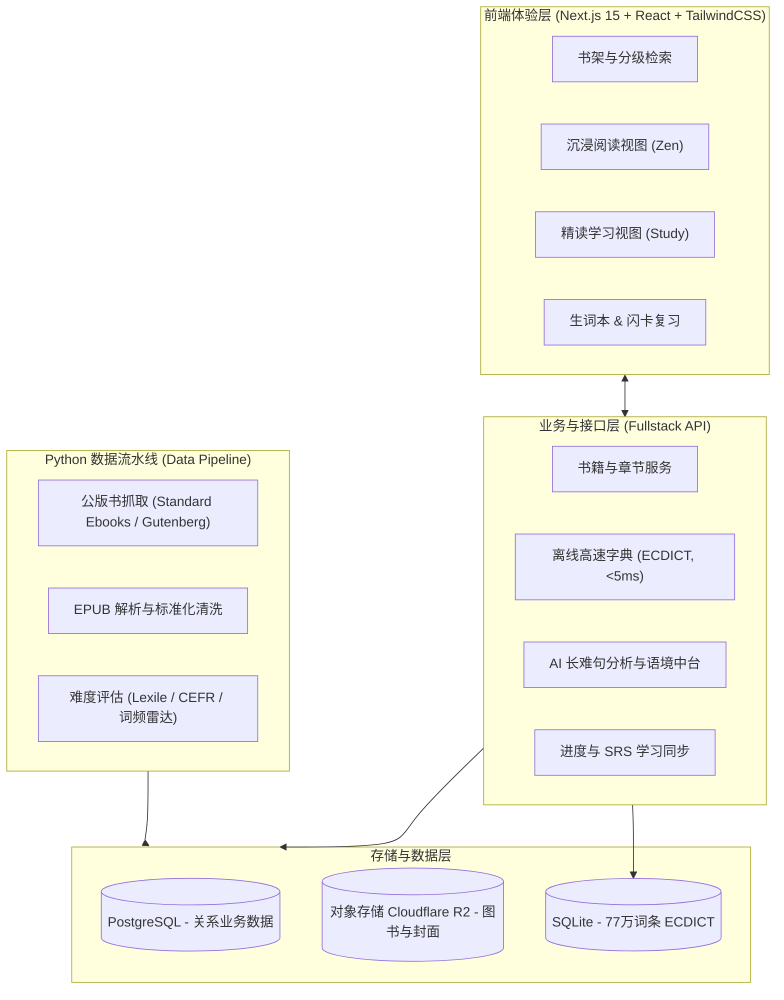

# EnglishReader (英文原著阅读平台)

> **优雅、高效、深度的双模式英文原著阅读平台**  
> 专为英语原著爱好者与学习者设计，兼顾「心流沉浸体验」与「深度精读吸收」。

---

## 📖 项目愿景

对于非母语读者而言，英文原著阅读长期存在痛点：
1. **频繁查词打断心流**：遇到生词停下来查字典，破坏阅读沉浸感；
2. **长难句与文化鸿沟**：语法结构复杂、俚语典故难以靠单字字典理解；
3. **生词脱节难吸收**：查完即忘，缺乏与上下文绑定的复习闭环；
4. **书籍难度不匹配**：不知选哪本书，盲目阅读容易受挫弃坑。

**EnglishReader** 旨在通过 **“双模式交互”** + **“自动化公版书难度分析流水线”** + **“AI 语境辅助”**，打造一套现代化的英文阅读新体验。

---

## 🌟 核心特性

### 1. 双模式阅读（One-click Mode Switch）
* 🧘 **沉浸阅读模式 (Zen / Flow Mode)**
  * 极简居中排版、纯净无打扰界面；
  * **低打扰气泡查词**：轻点单词即弹极简释义，即查即走，保护阅读心流；
  * 支持自定义排版、背景色温、无边框全屏阅读。
* 🎓 **学习精读模式 (Study Mode)**
  * **分级词汇热力图**：根据用户水平（CET-4/6、考研、托福、雅思、GRE）轻量标色超纲词汇；
  * **AI 语法树与长难句拆解**：一键拆解从句嵌套、修饰成分与通顺地道意译；
  * **深度词卡**：词根词缀、固定搭配、原句例句与发音音频；
  * **文化背景注脚**：AI 即时解读文学隐喻、时代典故。

### 2. 公版图书数据与难度评级流水线 (Data Pipeline)
* **优质来源同步**：优先接入高质量排版的 [Standard Ebooks](https://standardebooks.org/) 与海量图书的 [Project Gutenberg](https://www.gutenberg.org/)；
* **结构化清洗**：自动化提取章节、清理旧版排版杂质、规范化 HTML 片段；
* **多维度难度评估**：
  * **Flesch-Kincaid / 蓝思指数 (Lexile)** 可读性评分；
  * **CEFR 分级 (A1 ~ C2)**；
  * **词汇分布雷达**（展示 CET-4/6/GRE/Rare 词汇占比），读者挑书一目了然。

### 3. 高性能与低成本查词体系
* **L1 本地缓存**：浏览器 IndexedDB 缓存高频生词；
* **L2 毫秒级离线词典**：基于开源 77 万词条的 `ECDICT`，单次检索 < 5ms，覆盖基础考纲标签与词频；
* **L3 AI 语境释义**：仅对复杂长句、多义熟词生义按需调用 LLM，大幅降低 API 成本。

### 4. 记忆闭环 (Vocabulary & SRS)
* **语境生词本**：生词自动绑定原文出处句子与书籍章节；
* **内置间隔重复算法 (SM-2 / FSRS)**：智能安排复习周期，支持一键导出到 Anki。

---

## 🏗️ 系统架构图



---

## 📁 规划目录结构

```text
EnglishReader/
├── apps/
│   ├── web/                         # 前端应用 (Next.js 15 App Router + TailwindCSS)
│   │   ├── app/                     # 路由系统 (书架、双模式阅读器、生词本、API)
│   │   ├── components/              # 业务组件 (ZenReader, StudyDrawer, DictCard)
│   │   └── lib/                     # 词典查询、CFI 锚点与阅读器逻辑
│   │
│   └── pipeline/                    # Python 数据处理流水线
│       ├── scrapers/                # Standard Ebooks / Gutenberg 爬虫脚本
│       ├── analyzers/               # 难度评估 (Flesch-Kincaid, CEFR, 词频统计)
│       ├── cleaners/                # EPUB 提取规范化脚本
│       └── main.py                  # CLI 入口
│
├── packages/
│   ├── database/                    # 数据库模型 (Prisma / Drizzle ORM)
│   └── types/                       # 共享 TypeScript 类型定义
│
└── README.md
```

---

## 🚀 开发路线图 (Roadmap)

- [ ] **Phase 1: 基础设施与数据验证**
  - [ ] 搭建 Python 数据清洗脚本，跑通首批 Standard Ebooks 经典书籍（如《了不起的盖茨比》）；
  - [ ] 实现文本难度评分与词频统计分析；
  - [ ] 准备本地 ECDICT 词典 SQLite 数据源。
- [ ] **Phase 2: 双模式阅读器 MVP**
  - [ ] 初始化 Next.js 15 项目与 Tailwind 基础排版；
  - [ ] 实现章节翻页与 Zen 模式 / Study 模式一键切换；
  - [ ] 实现前端快速查词弹窗与侧边栏。
- [ ] **Phase 3: AI 与深度学习闭环**
  - [ ] 接入 LLM 流式长难句拆解与语法分析；
  - [ ] 语境生词本、划线高亮保存与 SRS 复习模块。
- [ ] **Phase 4: 多模态与沉浸伴读**
  - [ ] 接入高拟真神经 TTS 伴读与文字同步高亮；
  - [ ] 完善多端响应式（移动端/平板/桌面端）。

---

## 📜 版权与开源协议

本项目爬取与整理的书籍均来自公有领域（Public Domain，如 Standard Ebooks 与 Project Gutenberg），遵循宽松的开源与公开版权协议。
